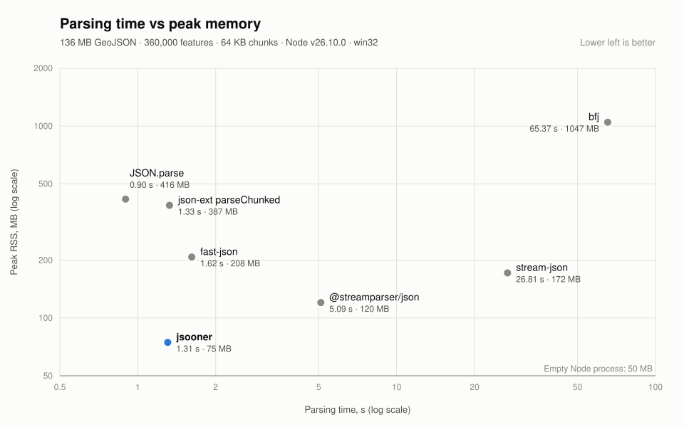

# Benchmarks

Compares jsooner with other JSON parsers. jsooner is loaded from `dist/`, so build first.

```bash
pnpm build
node bench/generate.mjs          # writes bench/data/big.geojson (360k features, ~136 MB, gitignored)
node bench/run.mjs               # all parsers, one process each: time and peak RSS, plus a scatter plot
node bench/large-item.mjs        # one large object across many chunks: confirms the decoder stays linear
```

`pnpm bench` runs the build, generator and both benchmarks in one go.

- `generate.mjs [count] [file]`: deterministic GeoJSON `FeatureCollection`; strings contain escaped quotes and braces.
- `run.mjs [file]`: runs `parse.mjs <parser> [file]` for every adapter in `parsers.mjs`, prints a markdown table, and writes `assets/benchmark-results.json` and the scatter plot as `assets/benchmark.svg` and `assets/benchmark.png`. Run `parse.mjs` directly to measure one parser (it prints one line of JSON).
- `chart.mjs [results] [out]`: redraws the scatter plot from a saved `benchmark-results.json` without rerunning the benchmark. The x axis is parsing time and the y axis is peak RSS, both on log scales because the parsers differ by ratios (bfj is ~50× slower than JSON.parse). jsooner is highlighted, and a reference line marks the RSS of an empty Node process. Rendered with `@resvg/resvg-js`, so no browser is needed.
- `large-item.mjs [sizesMb]`: comma-separated sizes, default `2,8,32`. The 32 MB case takes about 40 s with the current decoder.
- `memory.mjs [file]`: breaks jsooner's peak RSS into runtime baseline, stream plumbing, chunk size and GC settings, each scenario in its own process.
- `time-breakdown.mjs [file]`: times jsooner's stages from disk and in memory against json-ext and `JSON.parse`, best of 3 warm runs. Disk rows vary noticeably between invocations, so run it more than once.



Every streaming parser reads the file in 64 KB chunks; `JSON.parse` and fast-json (which has no chunked input) read it whole. Results depend on hardware and Node version, so compare ratios rather than absolute times.
